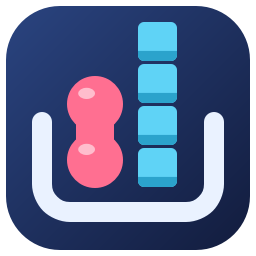

# Universal Engine Dock — swap Puyo Puyo and Tetris engines (AI) in and out

[日本語](README.md) | **English**



**Universal Engine Dock (UED) is a free, open-source Windows tool that connects interchangeable Puyo Puyo and Tetris engines (AI bots) to Puyo Puyo Tetris 2.**
It reads the board of the Steam version from the screen and shows the selected engine's next move on top of the game. Simulators and practice screens are included.

| Item | Details |
|---|---|
| Supported game | Puyo Puyo Tetris 2 on Steam (Puyo and Tetris, versus and solo) |
| Bundled engines | Puyo: YamaNEKO / Tetris: KasugAI (both MIT License) |
| Engines you can connect | Tetris: any TBP (Tetris Bot Protocol) bot such as Cold Clear 2 / Puyo: anything that follows the published JSON protocol |
| Requirements | Windows 10 / 11 (64-bit). No GPU, Python or administrator rights needed |
| Price and license | Free, GPL v3 |

> This is an unofficial fan-made tool by an individual. It is not affiliated with SEGA Corporation or The Tetris Company.
> "Puyo Puyo" and "Tetris" are registered trademarks of their respective owners.
> Check the game's terms of service and the rules of your tournament, stream and opponent before using it.

## The idea

The model is **USB**.

Before USB became common, PCs had a different socket for each device: a parallel port for the printer, a serial port for the modem,
and yet other sockets for the mouse and keyboard. USB settled on one kind of port, so that a device made by anyone works once you plug it in.

Game engines are in a similar place today. Each engine takes its input and returns its output in its own way,
and every engine author has to rebuild the screen reading and the display of moves.

Universal Engine Dock is a dock that **unifies the port between the game and the engine**.

- **If you make engines** — you only write the part that takes a board and returns a move. No screen reading, no display
- **If you use engines** — swap the engine and compare many of them on the same screen with the same controls
- **The port is public** — engines by anyone, in any language, can connect. Existing standards (TBP for Tetris) are used as they are

The names "Universal" and "Dock" come from this idea. The port itself is described in the [engine specification](docs/ENGINE_SPEC.en.md).

## What you can do with Puyo Puyo and Tetris AI

- **Assist mode** — choose "Puyo / Tetris / No assist" and an engine for each side (1P, 2P, solo), and see the next move
- **Engine registration** — add your own or public engines from "Register engines…" (a JSON protocol for Puyo, TBP for Tetris)
- **Simulators and practice** — Puyo and Tetris simulators, infinite 4-wide REN
- **OBS output** — send the display to an OBS browser source
- **Languages** — Japanese and English

## Requirements

- Windows 10 / 11 (64-bit)
- Puyo Puyo Tetris 2 on Steam (windowed). Some capture-board video also works after you align the positions by hand

## How to use (release build)

1. Extract the zip from [Releases](https://github.com/fiss-vinbows/Universal_Engine_Dock/releases) and run `UniversalEngineDock.exe`
2. Start the game in a window and press "Detect game window" (ゲームのウィンドウを検出)
3. Choose a game and an engine for each side and press "Start assist mode" (支援モード開始)

The app starts in Japanese. [Switch it to English](docs/INSTALL.en.md#switch-the-display-to-english) first.

Manuals:

- [Installation](docs/INSTALL.en.md) — installing, starting, troubleshooting
- [Engine specification and registration](docs/ENGINE_SPEC.en.md) — the protocol for adding your own or public engines, with samples

The bundled engines are YamaNEKO (Puyo) and KasugAI (Tetris), both under the MIT License. Others can be added from "Register engines…".
For Tetris, [Cold Clear 2](https://github.com/MinusKelvin/cold-clear-2) is confirmed to work without any changes
([how to register it](docs/ENGINE_SPEC.en.md#using-cold-clear-2)).
YamaNEKO uses the core of [ama](https://github.com/citrus610/ama) (MIT License) for board handling
and needs a CPU with BMI2 instructions (roughly 4th-gen Intel Core or later, or AMD Ryzen or later).

### About security software warnings

The exe is not code-signed and does not have many users yet, so you may see these warnings.

- **Windows SmartScreen** ("Windows protected your PC") — choose "More info" → "Run anyway"
- **Norton and others** — a new exe from the internet may be stopped and analyzed. You can start it after the analysis.
  Each engine exe (inside `engines/`) may also be analyzed the first time

To check that the zip is the one on the release page, compare the SHA-256 on that page with the result of this command.

```powershell
Get-FileHash .\UniversalEngineDock-0.1.0.zip
```

Once you have checked it, right-click the zip **before extracting** → "Properties" → tick "Unblock".
The files inside are then no longer treated as files from the internet, and warnings become less likely.

The tool reads the game screen and runs the engine as a separate process. It does not use administrator rights.

## FAQ

### What is Universal Engine Dock?

It is a dock that connects Puyo Puyo and Tetris engines (AI) to the game. The dock reads the screen and displays the move,
the engine does the thinking, so you can replace the engine alone.

### Can I play Puyo Puyo Tetris 2 while seeing the AI's moves?

Yes. Run the Steam version in a window and press "Start assist mode". Dots on top of the game show where to place the next piece.
You can use it to practice stacking or to study how an engine plays.

### May I use it in online matches?

Follow the game's terms of service and the rules of the tournament and your opponent. We do not recommend using it against a person without their consent.

### Which engines work?

YamaNEKO for Puyo and KasugAI for Tetris are bundled. For Tetris you can add any TBP bot, and Cold Clear 2 works as it is.
ama for Puyo can be used if you write a program (bridge) that follows the [protocol](docs/ENGINE_SPEC.en.md#4-puyo-protocol).

### Can I connect my own AI?

Yes. Any executable that exchanges one JSON per line over standard input and output can connect, whatever language it is written in.
See the [engine specification](docs/ENGINE_SPEC.en.md) and the Python samples that run as they are.

### How does it read the screen?

It reads the board, next and hold from the image of the game window by image processing. It does not modify the game's files.

### Why is it flagged as a virus?

Because the exe is not signed and does not have many users yet. See [About security software warnings](#about-security-software-warnings).

### Does it work with the Nintendo Switch version?

It may work if you show the capture-board video on your PC and align the board position. Depending on the colors and borders of the video, it may not be read correctly.

## Running from source

Python 3.12 or later is required.

```powershell
python -m venv venv
venv\Scripts\pip install -r requirements.txt
.\start.bat
```

The following data is not in the repository. The other features work without it.

- Piece sequences of the actual game (`assets/haipuyo.txt.gz`) — without it, the simulator does not offer the actual-sequence mode
- Digit samples for reading the Puyo score (`config/puyo_score_digits.npz`) — you can make it from your own recording with `tools/make_puyo_score_digits.py`.
  Without it, chain scores come only from simulation
- Engine executables (`engines/`)

## Layout

- `uedock/games/puyo/`, `uedock/games/tetris/` — game modes (screen reading, state tracking, display, simulators)
- `uedock/game_mode.py` — where game modes are registered
- `uedock/plugin_api.py`, `uedock/extension.py` — plugins (`plugins/<name>/plugin.py`)
- `uedock/engine_registry.py` — engine registration and the choice for each side
- `uedock/ui/` — main window
- `tests/` — tests. `venv\Scripts\python -m unittest discover -s tests -t .`
- `tools/build_exe.py` — builds the release (usage at the top of the file)

Code comments are in Japanese.

## License and credits

- The tool itself is under [GPL v3](LICENSE). License texts of the bundled libraries and engines are in `licenses/` of the release
- The Tetris opener diagrams come from [テトリス堂 (Tetris-do)](https://shiwehi.com/tetris/) (the URL of each diagram is in the data)
- The small sample images used to read the screen (`vision/templates/`) are cut out of the game screen and belong to their respective owners
