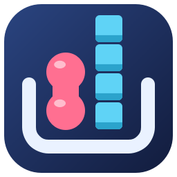

# Universal Engine Dock — ぷよぷよ・テトリスの思考エンジン(AI)を差し替えて使う支援ツール

**日本語** | [English](README.en.md)



**Universal Engine Dock(略称 UED)は、ぷよぷよとテトリスの思考エンジン(AI)を差し替えて使える、Windows 用の無料・オープンソースの支援ツールです。**
Steam 版「ぷよぷよテトリス2」の盤面を画面から読み取り、選んだエンジンの次の一手をゲームの上に表示します。シミュレーターと練習画面も付いています。

| 項目 | 内容 |
|---|---|
| 対応するゲーム | Steam 版「ぷよぷよテトリス2」(ぷよ・テトリス、対戦・一人用) |
| 同梱のエンジン | ぷよ: YamaNEKO / テトリス: KasugAI(どちらも MIT License) |
| つなげるエンジン | テトリス: TBP(Tetris Bot Protocol)互換(Cold Clear 2 など) / ぷよ: 公開している JSON の規格に合わせたもの |
| 動作環境 | Windows 10 / 11(64bit)。GPU・Python・管理者権限は不要 |
| 料金・ライセンス | 無料、GPL v3 |

*English: Universal Engine Dock (UED) is a free, open-source Windows tool that connects interchangeable Puyo Puyo and Tetris engines (AI bots)
to Puyo Puyo Tetris 2 on Steam. It reads the board from the screen and shows the engine's suggested move as an overlay. Any TBP (Tetris Bot Protocol)
bot such as Cold Clear 2 works for Tetris; Puyo engines talk a simple documented JSON protocol over stdin/stdout. The UI is available in English.*

> 本ツールは個人が作った非公式のファンツールであり、株式会社セガおよび The Tetris Company とは関係ありません。
> 「ぷよぷよ」「テトリス(Tetris)」は各社の登録商標です。
> ゲームの利用規約と、大会・配信・対戦相手とのルールを確かめて使ってください。

## 考え方

手本にしたのは **USB** です。

USB が広まる前のパソコンは、プリンターはパラレルポート、モデムはシリアルポート、マウスとキーボードはまた別の口と、
機器ごとに差し込み口が違いました。USB は口の規格を1つに揃え、どこが作った機器でも、差せば使えるようにしました。

ゲームの思考エンジンも、よく似た状態にあります。エンジンごとに渡し方も受け取り方も違い、
画面の読み取りや手の表示まで、エンジンを作る人がそれぞれ作り直しています。

Universal Engine Dock は、**ゲームとエンジンの間の口を揃える**ためのドックです。

- **エンジンを作る人** — 盤面を受け取って手を返すところだけを作ればよい。画面の読み取りも表示も要らない
- **使う人** — エンジンを差し替えるだけで、同じ画面・同じ操作のまま、いろいろなエンジンを試して比べられる
- **口の決まりは公開する** — だれが、どの言語で作ったエンジンでもつながる。既にある規格(テトリスの TBP)は、そのまま使う

名前の「Universal」と「Dock」は、この考えから来ています。口の決まりは[思考エンジンの規格](docs/ENGINE_SPEC.md)にあります。

## ぷよぷよ・テトリスの AI でできること

- **支援モード** — サイド(1P・2P・一人用)ごとに「ぷよ / テトリス / 支援なし」と思考エンジンを選び、次の手を表示する
- **エンジンの登録** — 自作・公開のエンジンを「エンジンの登録…」から足せる(ぷよは独自の JSON 形式、テトリスは TBP 互換)
- **シミュレーター・練習** — ぷよ・テトリスのシミュレーター、無限中あけREN
- **OBS 出力** — 表示を OBS のブラウザソースに出す
- **表示の言語** — 日本語・英語

## 動作環境

- Windows 10 / 11(64bit)
- Steam 版「ぷよぷよテトリス2」(ウィンドウ表示)。キャプチャボードの映像は、位置合わせをすれば使えるものもある

## 使い方(配布物)

1. Releases の zip を展開し、`UniversalEngineDock.exe` を起動する
2. ゲームをウィンドウ表示で起動し、「ゲームのウィンドウを検出」を押す
3. サイドごとにゲーム種別と思考エンジンを選び、「支援モード開始」を押す

説明書:

- [導入方法](docs/INSTALL.md) — 入れ方、始め方、困った時
- [思考エンジンの規格と登録のしかた](docs/ENGINE_SPEC.md) — 自作・公開のエンジンを足す時の通信の形式、サンプル

同梱の思考エンジンは、ぷよの YamaNEKO とテトリスの KasugAI です(どちらも MIT License)。ほかのエンジンは「エンジンの登録…」から登録できます。
テトリスは、[Cold Clear 2](https://github.com/MinusKelvin/cold-clear-2) が、手を加えずそのまま動くことを確かめています
([登録のしかた](docs/ENGINE_SPEC.md#cold-clear-2-を使う))。
YamaNEKO は、盤面処理に [ama](https://github.com/citrus610/ama) の core(MIT License)を使っています。
動かすには BMI2 命令のある CPU(Intel は第4世代 Core 以降、AMD は Ryzen 以降が目安)が要ります。

### セキュリティソフトの警告について

exe に署名が無く、利用者もまだ少ないので、次のような警告が出ることがあります。

- **Windows の SmartScreen**(「Windows によって PC が保護されました」) — 「詳細情報」→「実行」で起動できます
- **ノートンなど** — インターネットから入れた新しい exe として、起動を止めて調べることがあります。調べ終わると起動できます。
  思考エンジンの exe(`engines/` の中)も、それぞれ最初の1回に調べられることがあります

zip がリリースのページのものと同じかは、ページに書いた SHA-256 と、次のコマンドの結果を比べると確かめられます。

```powershell
Get-FileHash .\UniversalEngineDock-0.1.0.zip
```

確かめたうえで、**展開する前に** zip を右クリック →「プロパティ」→「許可する」(ブロックの解除)にチェックを入れると、
中のファイルが「インターネットから入れたファイル」の扱いにならず、警告が出にくくなります。

このツールは、ゲームの画面を読み取り、思考エンジンを別のプロセスとして動かします。管理者権限は使いません。

## よくある質問

### Universal Engine Dock とは何ですか?

ぷよぷよとテトリスの思考エンジン(AI)を、ゲームにつなぐためのドックです。画面の読み取りと手の表示を受け持ち、
考えるところはエンジンに任せるので、エンジンだけを差し替えられます。

### ぷよぷよテトリス2 で、AI の手を見ながら遊べますか?

はい。Steam 版をウィンドウ表示で起動し、「支援モード開始」を押すと、次に置く場所がゲームの上に丸で出ます。
置き方の練習や、エンジンの考え方の研究に使えます。

### オンライン対戦で使ってもよいですか?

ゲームの利用規約と、大会・対戦相手とのルールに従ってください。相手の了承なく対人戦で使うことは勧めません。

### どの思考エンジンが使えますか?

ぷよは YamaNEKO、テトリスは KasugAI を同梱しています。テトリスは TBP 互換のエンジンを足せ、Cold Clear 2 はそのまま動きます。
ぷよの ama は、[規格](docs/ENGINE_SPEC.md#4-ぷよの規格)に合わせるプログラム(ブリッジ)を作れば使えます。

### 自分で作った AI をつなげられますか?

はい。標準入出力で JSON を1行ずつやり取りする実行ファイルなら、言語を問わずつながります。
[思考エンジンの規格](docs/ENGINE_SPEC.md)と、そのまま動く Python のサンプルがあります。

### 画面はどうやって読み取っていますか?

ゲームのウィンドウの画像から、盤面・ネクスト・ホールドを画像処理で読み取ります。ゲームのファイルは書き換えません。

### ウイルスと警告されるのはなぜですか?

exe に署名が無く、利用者がまだ少ないためです。[セキュリティソフトの警告について](#セキュリティソフトの警告について)を見てください。

### Nintendo Switch 版でも使えますか?

キャプチャボードの映像を PC に映し、盤面の位置を合わせると、使えることがあります。映像の色や縁の付き方によっては正しく読めません。

## ソースからの起動

Python 3.12 以降が必要です。

```powershell
python -m venv venv
venv\Scripts\pip install -r requirements.txt
.\start.bat
```

次のデータはリポジトリに入れていません。無くても、ほかの機能は動きます。

- 実機の配ぷよのデータ(`assets/haipuyo.txt.gz`) — 無ければ、シミュレーターに配ぷよモードが出ない
- ぷよの点数表示を読む数字の見本(`config/puyo_score_digits.npz`) — 自分の録画から `tools/make_puyo_score_digits.py` で作れる。
  無ければ、連鎖の点数は再現だけで出す
- 思考エンジンの実行ファイル(`engines/`)

## 構成

- `uedock/games/puyo/`・`uedock/games/tetris/` — ゲームモード(画面の読み取り、状態の追跡、表示、シミュレーター)
- `uedock/game_mode.py` — ゲームモードの登録口
- `uedock/plugin_api.py`・`uedock/extension.py` — プラグイン(`plugins/<名前>/plugin.py`)
- `uedock/engine_registry.py` — エンジンの登録と、サイドごとの選択
- `uedock/ui/` — メイン画面
- `tests/` — テスト。`venv\Scripts\python -m unittest discover -s tests -t .`
- `tools/build_exe.py` — 配布物の作成(使い方はファイルの先頭)

## ライセンスと出典

- 本体は [GPL v3](LICENSE)。同梱するライブラリとエンジンのライセンス文は、配布物の `licenses/` にある
- テトリスの開幕テンプレの図は[テトリス堂](https://shiwehi.com/tetris/)を出典とする(各図の URL はデータに記載)
- 画面の読み取りに使う小さな見本画像(`vision/templates/`)はゲームの画面から切り出したもので、権利は各社にある
